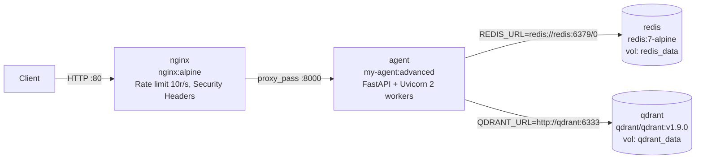

# Day 14 Lab — Mission Answers

- **Môi trường kiểm chứng:** Windows 11 Home, Ubuntu trên WSL 2 (`os.name = posix`), Python 3.11.18 dùng để chạy grader, Docker 29.9.3 và Compose v5.7.1. [Kết quả kiểm tra môi trường](evidence/submission/wsl_lab14_environment.txt).

---

## Part 1: Localhost vs Production (CP1)

### Exercise 1.1: Anti-patterns trong `01-localhost-vs-production/develop/app.py`

Đọc trực tiếp [app.py](01-localhost-vs-production/develop/app.py), phát hiện 7 anti-pattern thực tế:

1. **Hardcode secret và credential trong mã nguồn** ([app.py#L17-L18](01-localhost-vs-production/develop/app.py#L17-L18)):
   `OPENAI_API_KEY = "<DEMO_KEY_REDACTED>"` và `DATABASE_URL = "<DEMO_DATABASE_URL_REDACTED>"`. Nếu push lên GitHub, secret lộ vĩnh viễn trong lịch sử Git; kẻ tấn công có thể dùng key gây thiệt hại tài chính hoặc xâm nhập DB.
2. **Không quản lý cấu hình theo môi trường (12-Factor)** ([app.py#L21-L22](01-localhost-vs-production/develop/app.py#L21-L22)):
   `DEBUG = True` và `MAX_TOKENS = 500` viết cứng, không thể đổi giữa `development`/`staging`/`production` mà không sửa code.
3. **Dùng `print()` thay structured logging và in trực tiếp secret ra stdout** ([app.py#L33-L34](01-localhost-vs-production/develop/app.py#L33-L34)):
   `print(f"[DEBUG] Using key: {OPENAI_API_KEY}")` làm lộ API key vào log tập trung; log không có timestamp, level hay cấu trúc JSON để lọc/truy vấn.
4. **Thiếu liveness/readiness probe (`/health`, `/ready`)** ([app.py#L42-L43](01-localhost-vs-production/develop/app.py#L42-L43)):
   Chỉ có `GET /`, nên container orchestrator/load balancer không phân biệt được process còn sống hay đã sẵn sàng nhận traffic.
5. **Bind `localhost` và cứng `port=8000`** ([app.py#L51-L52](01-localhost-vs-production/develop/app.py#L51-L52)):
   `host="localhost"` chỉ lắng nghe loopback `127.0.0.1` (bên ngoài container hoặc proxy không truy cập được), còn `port=8000` bỏ qua biến `PORT` do Railway/Render/Cloud Run cấp.
6. **Bật `reload=True` khi chạy server** ([app.py#L53](01-localhost-vs-production/develop/app.py#L53)):
   File watcher tốn tài nguyên, dễ restart tiến trình ngoài ý muốn trong production.
7. **Không xử lý lifecycle / graceful shutdown và nhận input qua query param** ([app.py#L31](01-localhost-vs-production/develop/app.py#L31)):
   Endpoint `def ask_agent(question: str)` ép dữ liệu hỏi qua query URL (dễ lộ câu hỏi vào access log/proxy URL và bị giới hạn độ dài), đồng thời thiếu `lifespan` cleanup và dễ bị 422 nếu client gửi JSON body.

### Exercise 1.2: Chạy thực tế bản `develop`

Bằng chứng lưu tại [part1_cp1.txt](evidence/submission/part1_cp1.txt) (cwd: `01-localhost-vs-production/develop`, `venv/part14`).

- Gọi đúng query param `POST http://localhost:8000/ask?question=Hello` → **`200 OK`**:

```http
HTTP/1.1 200 OK
content-type: application/json

{"answer":"Agent đang hoạt động tốt! (mock response) Hỏi thêm câu hỏi đi nhé."}
```

- Trên stdout của server xuất hiện dòng in khóa mẫu ra log: `[DEBUG] Using key: <DEMO_KEY_REDACTED>`.
- Gửi JSON `{"question":"Hello"}` vào bản `develop` → **`422 Unprocessable Entity`**:

```http
HTTP/1.1 422 Unprocessable Entity
content-type: application/json

{"detail":[{"type":"missing","loc":["query","question"],"msg":"Field required","input":null}]}
```

### Exercise 1.3: Chạy thực tế bản `production` và bảng so sánh đánh giá code thật

Chạy `01-localhost-vs-production/production/app.py` với `ENVIRONMENT=staging PORT=8000` ([part1_cp1.txt](evidence/submission/part1_cp1.txt#L37-L74)):
- `GET /health` → `200 OK`: `{"status":"ok","uptime_seconds":0.4,"version":"1.0.0","environment":"staging","timestamp":"2026-11-25T16:14:11.940611+00:00"}`
- `GET /ready` → `200 OK`: `{"ready":true}`
- `POST /ask` (JSON `{"question":"Hello"}`) → `200 OK`: `{"question":"Hello","answer":"Đây là câu trả lời từ AI agent (mock). Trong production, đây sẽ là response từ OpenAI/Anthropic.","model":"gpt-4o-mini"}`

| Khía cạnh | `develop/app.py` | `production/app.py` + `config.py` | Ý nghĩa thực tế & Hạn chế còn tồn tại trong mã mẫu |
| --- | --- | --- | --- |
| **Config & Env** | Hardcode `DEBUG`, `MAX_TOKENS`, key trong code | Đọc `HOST`, `PORT`, `DEBUG`, `ENVIRONMENT`, `AGENT_API_KEY` qua `Settings` (`os.getenv`) | Tách config khỏi code giúp chạy cùng artifact qua dev/staging/prod. **Hạn chế:** không gọi `load_dotenv()`, nên file `.env` không tự nạp nếu chạy `python app.py` trực tiếp. |
| **Secrets** | Hardcode khóa và mật khẩu mẫu; `print()` secret | Không hardcode secret; `validate()` bắt `AGENT_API_KEY` khi `ENVIRONMENT=production` | Tránh lộ key qua Git. **Hạn chế:** `production/app.py` đọc `settings.api_key` trong `config.py` nhưng **không hề kiểm tra `X-API-Key` trên `/ask`**. |
| **Logging** | `print("[DEBUG] ...")` văn bản tự do | Định nghĩa `logging.basicConfig(format='{"time":...,"msg":"%(message)s"}')` + `json.dumps(...)` | **Lỗi thật khi chạy:** `from config import settings` (L24) gọi `logging.warning(...)` (`config.py#L45`) **trước** `logging.basicConfig()` (L28) làm handler mặc định gắn vào root logger; `basicConfig` bị bỏ qua nên không có JSON log app nào được in (`part1_cp1.txt#L66`). Ngoài ra lồng `json.dumps` vào chuỗi format `%(message)s` làm JSON hỏng escape dấu ngoặc kép. |
| **Health / Readiness** | Không có `/health` hay `/ready` | Có `GET /health` và `GET /ready` dùng cờ `is_ready` | Platform phân biệt được process sống (liveness) và sẵn sàng nhận tải (readiness). **Hạn chế:** `/ready` chưa kiểm tra dependency thật (Redis/DB). |
| **Bind & Port** | `host="localhost"`, `port=8000` | `host=settings.host` (`0.0.0.0`), `port=settings.port` (`PORT`) | `0.0.0.0` nhận kết nối từ container/LB; `PORT` tương thích PaaS. |
| **Debug / Reload** | `reload=True` cố định | `reload=settings.debug` (`DEBUG=false` mặc định) | Tắt auto-reload trong staging/production. |
| **Shutdown & Concurrency** | Không xử lý shutdown | Có `lifespan` (`is_ready = False`) và `signal.signal(SIGTERM, handle_sigterm)` | **Lỗi nghiêm trọng:** đăng ký `signal.signal(SIGTERM, handle_sigterm)` ở L189 mà **không lưu và gọi lại handler cũ của Uvicorn** → trên Linux/POSIX có thể chặn Uvicorn thoát khi nhận `SIGTERM`. Thêm nữa `ask(question)` (L117) gọi `time.sleep` đồng bộ bên trong `async def`, làm nghẽn event loop. |

---

## Part 2: Docker (CP2)

### Exercise 2.1: Trả lời 4 câu hỏi về `02-docker/develop/Dockerfile`

Dựa trên [Dockerfile](02-docker/develop/Dockerfile):

1. **Base image là gì?**
   `FROM python:3.11` (L8) — bản phân phối đầy đủ Debian + Python 3.11 + compiler/build tools (~1 GB), nặng hơn nhiều so với `python:3.11-slim`.
2. **Working directory là gì?**
   `WORKDIR /app` (L11) — đặt thư mục làm việc mặc định trong container là `/app` cho mọi lệnh `COPY`, `RUN`, `CMD` phía sau.
3. **Tại sao `COPY 02-docker/develop/requirements.txt .` phải đặt trước `COPY 02-docker/develop/app.py .`?**
   Docker build theo cơ chế cache từng layer từ trên xuống: nếu một layer thay đổi thì mọi layer phía sau mất cache. Đặt `COPY requirements.txt` và `RUN pip install --no-cache-dir -r requirements.txt` trước khi copy code nguồn giúp khi chỉ sửa `app.py`, Docker tái sử dụng cache của bước cài dependency rất chậm (chú ý `--no-cache-dir` chỉ tắt cache tải wheel của pip trong image chứ không tắt Docker build layer cache).
4. **`CMD` và `ENTRYPOINT` khác nhau thế nào?**
   `ENTRYPOINT` định nghĩa file/lệnh thực thi cố định của container (khó bị ghi đè trừ khi truyền `--entrypoint`); `CMD` cung cấp lệnh mặc định hoặc các tham số mặc định truyền cho `ENTRYPOINT`, và dễ dàng bị ghi đè khi chạy `docker run <image> <command_mới>`. Trong bản develop dùng `CMD ["python", "app.py"]` (exec form, không qua shell nên PID 1 là `python`).

### Exercise 2.2 & 2.3: Build image `my-agent:develop` vs `my-agent:advanced` và Multi-stage

- **Lệnh build chuẩn từ root repo:**
  `docker build -f 02-docker/develop/Dockerfile -t my-agent:develop .`
  `docker build -f 02-docker/production/Dockerfile -t my-agent:advanced .`
  (Bắt buộc build từ root repo vì các lệnh `COPY 02-docker/...` và `COPY utils/mock_llm.py` lấy context từ root).
- **Khác biệt định dạng request API:**
  - `02-docker/develop/app.py` (L21): `async def ask_agent(question: str)` → nhận `question` qua **query param** (`POST /ask?question=What+is+Docker?`); gửi JSON body sẽ bị `422`.
  - `02-docker/production/main.py` (L58-60): `body = await request.json()` → nhận **JSON body** (`{"question": "What is Docker?"}`).
- **Cách hoạt động của multi-stage trong `02-docker/production/Dockerfile`:**
  - Stage 1 (`builder`, `python:3.11-slim`): cài `gcc`, `libpq-dev` và chạy `pip install --no-cache-dir --user -r requirements.txt` vào `/root/.local`.
  - Stage 2 (`runtime`, `python:3.11-slim`): chỉ copy `/root/.local` sang `/home/appuser/.local`, copy `main.py` và `utils/mock_llm.py`, tạo user non-root `appuser`, khai báo `HEALTHCHECK` và `CMD ["uvicorn", "main:app", "--host", "0.0.0.0", "--port", "8000", "--workers", "2"]`. Nhờ loại bỏ `gcc`, `libpq-dev`, headers và apt cache ở Stage 1, image cuối nhỏ hơn đáng kể và giảm bề mặt tấn công.
  - **Kiểm tra lúc chạy:** image advanced import được FastAPI dưới UID 999. Python nhận đúng thư mục `/home/appuser/.local/lib/python3.11/site-packages`.
- **Công thức đo kích thước & trạng thái chạy thật:**
  - Công thức phần trăm chênh lệch: $\text{Giảm (\%)} = \frac{\text{Size}_{\text{develop}} - \text{Size}_{\text{advanced}}}{\text{Size}_{\text{develop}}} \times 100\%$.
  - **Số đo thực tế từ `docker image inspect`:** develop **1,667,800,577 byte (1,667.80 MB)**, advanced **239,815,343 byte (239.82 MB)**. Image advanced giảm **85.62%** theo đơn vị MB thập phân. Hai lần gọi `POST /ask` đều trả HTTP 200. [Kích thước image](evidence/submission/wsl_part2_sizes.txt) · [Kiểm tra Docker](evidence/submission/wsl_part2_docker.txt).

### Exercise 2.4: Kiến trúc Docker Compose (`02-docker/production/docker-compose.yml`)



- **Đường đi request thực tế theo [docker-compose.yml](02-docker/production/docker-compose.yml) và [nginx.conf](02-docker/production/nginx/nginx.conf):**
  1. Client gọi vào cổng `80` (hoặc `443` nếu có cert) của `nginx` (service `agent` không publish port ra host, mọi traffic đều nằm trong Docker network `internal`).
  2. `nginx` áp dụng rate limit `10r/s` (`burst=20 nodelay`, trả `429` JSON nếu vượt) và chèn security headers (`X-Frame-Options`, `X-Content-Type-Options`, ẩn `Server`), riêng `/health` bỏ rate limit và `access_log off`.
  3. `nginx` forward qua `proxy_pass http://agent_backend` tới `agent:8000` (chỉ khởi động sau khi `redis` và `qdrant` đều đạt `condition: service_healthy`).
  4. `agent` dùng `REDIS_URL=redis://redis:6379/0` và `QDRANT_URL=http://qdrant:6333` để trao đổi nội bộ với `redis` và `qdrant`.
- Compose nạp cấu hình ứng dụng từ `.env.local`. Tệp này thuộc cấu hình cục bộ và được Git bỏ qua.
- **Kiểm tra Compose:** `k5-day14-docker` khởi động đủ agent, Redis, Qdrant và Nginx. Qua Nginx trên loopback, `GET /health` và `POST /ask` đều trả HTTP 200. [Kết quả kiểm tra](evidence/submission/wsl_part2_docker.txt).

---

## Part 3: Cloud Deployment (CP6)

### So sánh `railway.toml` và `render.yaml`

Dựa trên các file cấu hình thật tại [03-cloud-deployment/railway/railway.toml](03-cloud-deployment/railway/railway.toml), [03-cloud-deployment/render/render.yaml](03-cloud-deployment/render/render.yaml) và cấu hình Part 6 tại [06-lab-complete/railway.toml](06-lab-complete/railway.toml), [06-lab-complete/render.yaml](06-lab-complete/render.yaml):

| Tiêu chí | `railway.toml` (TOML, per-service) | `render.yaml` (YAML Blueprint, multi-service) |
| --- | --- | --- |
| **Build / Runtime** | `builder = "DOCKERFILE"` (Part 6) hoặc `"NIXPACKS"` (mẫu Part 3); hỗ trợ `dockerfilePath = "Dockerfile"` | Khai báo rõ `runtime: docker` (Part 6) hoặc `runtime: python` (`buildCommand`, mẫu Part 3), `dockerfilePath`, `dockerContext`, `region`, `plan` |
| **Start Command & `PORT`** | Có thể dùng `CMD` của Dockerfile hoặc `startCommand = "... --port $PORT"`. Railway tự inject `PORT` | Blueprint `runtime: docker` chạy `CMD` trong `Dockerfile`; `runtime: python` dùng `startCommand: ... --port $PORT`. Render inject `PORT` tự động |
| **Health check** | `[deploy] healthcheckPath = "/health"`, `healthcheckTimeout = 30`, `restartPolicyType` | `healthCheckPath: /health` ngay dưới định nghĩa service web |
| **Secrets & Env vars** | Không khai báo trong `railway.toml`; đặt qua Dashboard hoặc `railway variables set` | Khai báo trực tiếp danh sách `envVars` trong YAML; giá trị nhạy cảm dùng `sync: false` (nhập tay trên UI) hoặc `generateValue: true` (Render tự sinh) |
| **Redis** | Không khai báo trong `railway.toml`; thêm plugin Redis riêng trên Railway project và nối biến `REDIS_URL` | Khai báo luôn dịch vụ `type: keyvalue` trong cùng Blueprint và tự nối `REDIS_URL` qua `fromService: {name, type: keyvalue, property: connectionString}` |
| **Root Dir / Build Context** | Thiết lập *Root Directory* = `06-lab-complete` tại Service Settings và đặt Config File thành `/06-lab-complete/railway.toml` | Khai báo `rootDir: 06-lab-complete`, `dockerfilePath: ./Dockerfile`, `dockerContext: .` trực tiếp trong `render.yaml` |

### Exercise 3.3: Mô tả CI/CD pipeline Cloud Run (`cloudbuild.yaml` & `service.yaml`)

Trong [cloudbuild.yaml](03-cloud-deployment/production-cloud-run/cloudbuild.yaml) và [service.yaml](03-cloud-deployment/production-cloud-run/service.yaml), pipeline có bốn bước:

1. Chạy `pytest tests/ -v` trong image Python 3.11 để kiểm tra mã.
2. Build image Docker, gắn tag `$COMMIT_SHA` và `latest`. Bước build dùng cache từ image trước.
3. Đẩy image lên registry trong dự án GCP theo đúng tag.
4. Deploy image theo commit lên Cloud Run, đặt giới hạn instance và tài nguyên, cấp secret qua Secret Manager. Manifest Knative khai báo concurrency và các probe `/health`, `/ready`.

### Trạng thái triển khai Agent Part 6

- **Exercise 3.2:** Agent Part 6 chạy trên Render, dùng Key Value làm Redis. URL public là `https://k5-day14-production-agent-d13t.onrender.com`. [Kiểm tra /health](https://k5-day14-production-agent-d13t.onrender.com/health)
- **Kết quả CP6:** `GET /health` → `200`, `GET /ready` → `200`, `POST /ask` thiếu key → `401`, `POST /ask` có key hợp lệ → `200`. [Cấu hình và minh chứng](DEPLOYMENT.md)

---

## Part 4: API Security (CP3)

### Exercise 4.1: API Key Authentication (`04-api-gateway/develop/app.py`)

- **Nơi kiểm tra API key:** hàm `verify_api_key` ([04-api-gateway/develop/app.py#L39-L54](04-api-gateway/develop/app.py#L39-L54)) dùng `APIKeyHeader(name="X-API-Key", auto_error=False)` và được gắn vào `/ask` qua `Depends(verify_api_key)`.
- **Hành vi khi thiếu / sai key trong code mẫu:** thiếu header `X-API-Key` trả **`401 Unauthorized`**; gửi sai giá trị so với `AGENT_API_KEY` trả **`403 Forbidden`** (lưu ý: sang Part 6 hợp đồng yêu cầu **cả thiếu và sai key đều trả `401`**).
- **Cách rotate API key an toàn không downtime:** không thay thế đột ngột 1 key duy nhất; dùng cơ chế hỗ trợ **tạm thời 2 key song song** (`AGENT_API_KEY` mới + `AGENT_API_KEY_PREVIOUS` hoặc danh sách key từ Secret Manager), phát hành key mới cho client, kiểm tra log xác nhận không còn request dùng key cũ rồi mới thu hồi key cũ.
- **Kết quả chạy thật (`AGENT_API_KEY=<REDACTED_DEMO_KEY>`, chạy với demo key theo hướng dẫn K5 đã được che trong bằng chứng, [part4_cp3.txt](evidence/submission/part4_cp3.txt#L3-L43)):**

```http
# 1) Không có X-API-Key → 401
HTTP/1.1 401 Unauthorized
content-type: application/json

{"detail":"Missing API key. Include header: X-API-Key: <your-key>"}

# 2) Sai X-API-Key → 403
HTTP/1.1 403 Forbidden
content-type: application/json

{"detail":"Invalid API key."}

# 3) Đúng X-API-Key (<REDACTED_DEMO_KEY>) → 200
HTTP/1.1 200 OK
content-type: application/json

{"question":"Hello","answer":"Đây là câu trả lời từ AI agent (mock). Trong production, đây sẽ là response từ OpenAI/Anthropic."}
```

### Exercise 4.2 & 4.3: JWT Authentication & Rate Limiting (`04-api-gateway/production/`)

Đã tắt server develop trước khi chạy `04-api-gateway/production/app.py` trên cùng cổng 8000 (sử dụng `venv/part4prod`). Output thực tế tại [part4_cp3.txt](evidence/submission/part4_cp3.txt#L45-L161) (đã che JWT token thành `<REDACTED_JWT_TOKEN>`):

1. **Thiếu Bearer token → `401 Unauthorized`:**
```http
HTTP/1.1 401 Unauthorized
www-authenticate: Bearer
content-type: application/json

{"detail":"Authentication required. Include: Authorization: Bearer <token>"}
```

2. **Token sai → `403 Forbidden`:**
```http
HTTP/1.1 403 Forbidden
content-type: application/json

{"detail":"Invalid token."}
```

3. **Lấy token tại `POST /auth/token` với `student / demo123` → `200 OK`:**
```http
HTTP/1.1 200 OK
content-type: application/json

{"access_token":"<REDACTED_JWT_TOKEN>","token_type":"bearer","expires_in_minutes":60,"hint":"Include in header: Authorization: Bearer <REDACTED_PREFIX>..."}
```

4. **Gọi liên tiếp 12 lần `POST /ask` với Bearer token của `student` (limit 10 req/phút):**
   - Requests 1 → 10: **`HTTP/1.1 200 OK`** (`requests_remaining` giảm từ `9` về `0`).
   - Requests 11 & 12: **`HTTP/1.1 429 Too Many Requests`**:
```http
HTTP/1.1 429 Too Many Requests
x-ratelimit-limit: 10
x-ratelimit-remaining: 0
x-ratelimit-reset: 1795623326
retry-after: 59
content-type: application/json

{"detail":{"error":"Rate limit exceeded","limit":10,"window_seconds":60,"retry_after_seconds":59}}
```

- **Thuật toán trong `rate_limiter.py`:** Dùng **Sliding Window Log (Counter dùng `deque` timestamp trong RAM)** ([rate_limiter.py#L17-L71](04-api-gateway/production/rate_limiter.py#L17-L71)). Mỗi request mới xóa các timestamp cũ hơn `now - 60`, kiểm tra `len(window) >= max_requests`, tính `retry_after = int(oldest + 60 - now) + 1`, trả về 429 cùng các header `Retry-After`, `X-RateLimit-*`. **Hạn chế:** lưu bằng `_windows: dict[str, deque]` trong RAM từng process nên không chia sẻ giữa nhiều worker/container và mất khi restart.
- **Giới hạn thật theo role và lý do không cho admin bypass vô hạn:**
  - `rate_limiter_user`: `10 req/phút` (`student`, `role="user"`).
  - `rate_limiter_admin`: `100 req/phút` (`teacher`, `role="admin"`, [rate_limiter.py#L86-L87](04-api-gateway/production/rate_limiter.py#L86-L87)) — tức là admin có **tier cao hơn chứ không bypass vô hạn**.
  - **Không nên cho mọi admin bypass vô hạn** vì: (1) nếu token admin bị lộ hoặc nhân viên chạy nhầm vòng lặp vô hạn, hệ thống vẫn bị bão tải/cạn tài nguyên và đốt tiền LLM không kiểm soát; (2) thiếu công bằng tài nguyên (noisy neighbor) ảnh hưởng user khác; (3) khó giới hạn bán kính sát thương trong kiểm thử bảo mật.

### Exercise 4.4: Cost Guard với Redis (10 USD/người dùng/tháng)

[MonthlyCostGuard](04-api-gateway/production/cost_guard.py) dùng khóa `budget:{user_id}:{YYYY-MM}` theo UTC, lấy `user_id` từ JWT đã xác thực. Redis lưu số nguyên theo đơn vị `10^-8 USD`. Lua kiểm tra giới hạn và giữ chỗ trong cùng một thao tác. Sang tháng mới, khóa đổi và số dư bắt đầu bằng 0. Khóa cũ hết hạn sau 32 ngày tính từ lần cập nhật cuối.

`/ask` giữ chỗ trước khi gọi LLM mock, dùng số token đầu vào và độ dài tối đa của câu trả lời mock để ước lượng. Khi có kết quả, endpoint ghi chi phí thực tế và trả lại phần giữ chỗ dư. Redis không truy cập được thì `/ask` trả `503`. Cơ chế giới hạn ngày của demo vẫn dùng để minh họa; hạn mức tháng và số dư trả về từ `/ask` dùng Redis.

**Kiểm tra:** đặt bộ đếm Redis của một tài khoản thử nghiệm ở đúng 10 USD. `/ask` bằng JWT của tài khoản đó trả `402`, tài khoản còn ngân sách trả `200`, và request thiếu JWT trả `401`. Lượt burst xác nhận `429`. [Kết quả kiểm tra](evidence/submission/part4_monthly_budget.txt).

---

## Part 5: Scaling & Reliability (CP4)

### Exercise 5.1 & 5.2: Health Check, Readiness & Graceful Shutdown (`05-scaling-reliability/develop/app.py`)

Đã chạy trực tiếp `05-scaling-reliability/develop/app.py` ([part5_cp4.txt](evidence/submission/part5_cp4.txt)):
- `GET /health` → `200 OK`: `{"status":"ok","uptime_seconds":0.4,"version":"1.0.0","environment":"development","timestamp":"...","checks":{"memory":{"status":"ok","used_percent":70.2}}}`
- `GET /ready` → `200 OK`: `{"ready":true,"in_flight_requests":1}`
- `POST /ask?question=Hello` → `200 OK`: `{"answer":"Tôi là AI agent được deploy lên cloud. Câu hỏi của bạn đã được nhận."}`

**Phân tích kỹ thuật từ mã nguồn [05-scaling-reliability/develop/app.py](05-scaling-reliability/develop/app.py):**
1. **Liveness (`/health`) vs Readiness (`/ready`):**
   - `/health` phản ánh liveness. Docker HEALTHCHECK đánh dấu trạng thái container; việc restart phụ thuộc vào nền tảng hoặc trình điều phối.
   - `/ready` kiểm tra cờ `_is_ready` (chỉ `True` sau khi startup xong và trước khi shutdown), nếu fail trả `503`, load balancer chỉ **ngừng route traffic mới** chứ không restart container.
2. **Graceful shutdown với request đang xử lý:** Middleware `track_requests` (L72-81) tăng `_in_flight_requests` khi nhận request và giảm trong `finally`. Khi shutdown, `lifespan` (L54-66) đặt `_is_ready = False` để báo LB cắt traffic mới, sau đó chờ tối đa `timeout = 30` giây đến khi `_in_flight_requests == 0` rồi mới thoát (cùng `timeout_graceful_shutdown=30` của Uvicorn).
3. **`SIGTERM` vs `SIGKILL`:**
   - `SIGTERM` (15) yêu cầu tiến trình kết thúc có kiểm soát để hoàn tất request và đóng tài nguyên. Ca Uvicorn độc lập trên POSIX kết thúc với mã tín hiệu `-15` sau khi chạy lifespan shutdown. Container agent trong phép thử Compose dừng với mã `0`.
   - `SIGKILL` (9): kernel chấm dứt tiến trình ngay lập tức, không thể catch hay cleanup, request đang chạy bị đứt ngang và container thoát với exit code `137` (`128 + 9`).
   - **Kiểm tra POSIX:** khi Uvicorn CLI import `app.py`, handler ở cấp module từng ghi đè handler của Uvicorn và tiến trình không thoát trong 10 giây. Sau khi bỏ đăng ký handler này, gửi `SIGTERM` lúc `POST /ask?question=Long%20task` còn đang xử lý. Request trả HTTP 200, lifespan ghi `Shutdown complete`, và subprocess kết thúc với `-15` (SIGTERM) sau khi dọn dẹp. [Kết quả SIGTERM](evidence/submission/wsl_part5_sigterm.txt).

### Exercise 5.3 – 5.5: Stateless Redis & Load Balancing (`05-scaling-reliability/production/`)

Phân tích mã thật tại [app.py](05-scaling-reliability/production/app.py), [docker-compose.yml](05-scaling-reliability/production/docker-compose.yml), [nginx.conf](05-scaling-reliability/production/nginx.conf) và [test_stateless.py](05-scaling-reliability/production/test_stateless.py):
- **Phiên trong Redis:** mỗi phiên dùng khóa `session:{session_id}`, TTL 3.600 giây. Giao dịch Redis lưu đồng thời cặp hỏi đáp và tăng số lượt, giữ tối đa 20 message. Khi Redis chưa sẵn sàng, `/health` giữ 200 còn `/ready` và `/chat` trả 503. Cùng tiến trình phục hồi sau khi Redis trở lại. Kiểm tra đồng thời ghi đủ lượt 1–12. [Kết quả kiểm tra](evidence/submission/part5_redis_recovery.txt).
- **Load balancing với Nginx:** stack mở cổng host **`8080`** map vào Nginx `:80`, endpoint là **`POST http://localhost:8080/chat`**. Nginx dùng Docker DNS (`resolver 127.0.0.11 valid=10s`), chèn header `X-Served-By $upstream_addr` và cấu hình failover `proxy_next_upstream error timeout http_503` qua tối đa 3 replica (`deploy.replicas: 3`).
- **Hành vi thực tế của `test_stateless.py`:** Script gửi 5 câu hỏi tuần tự tới `http://localhost:8080/chat` dùng chung `session_id`, thu thập tập `served_by` và kiểm tra `/chat/{session_id}/history` trả về đủ message; **bản thân `test_stateless.py` không tự kill replica**. Để chứng minh chịu lỗi khi mất 1 replica cần chạy thêm bước dừng 1 container `agent` trong project `k5-day14-scaling` rồi gửi tiếp request và khôi phục.
- **Kiểm tra Compose:** 5 lượt liên tiếp đi qua đủ 3 replica và giữ 10 message trong Redis. Sửa `turn` đếm dư một vì câu hỏi hiện tại đã được thêm vào history. Khi dừng một replica, tiến trình container thoát mã `0`, request trên phiên đang có đi qua replica còn lại, lịch sử của phiên đó có đủ 4 message, sau đó khôi phục 3 replica. [Kết quả scaling](evidence/submission/wsl_part5_scaling.txt).

---

## Part 6: Kết quả kiểm chứng local

Chạy từ `06-lab-complete/` trong Ubuntu WSL 2 với Python 3.11.18 và Docker.

| Lệnh | Kết quả | Bằng chứng |
|---|---|---|
| `python -m pytest -v tests/test_agent_production.py` | 18/18 test đạt, exit `0` | [pytest](evidence/submission/wsl_part6_pytest.txt) |
| `python check_production_ready.py --static-only` | 28/28 kiểm tra tĩnh đạt. Exit `1` vì grader ghi các mục runtime là chưa chạy | [Kiểm tra tĩnh](evidence/submission/wsl_part6_checker_static.txt) |
| `python check_production_ready.py` | 12/12 tiêu chí, 43/43 kiểm tra đạt, exit `0` | [Grader đầy đủ](evidence/submission/wsl_part6_checker_full.txt) |

Kiểm tra Compose qua `PORT=18106` cho thấy PID 1 là Uvicorn, tiến trình chạy với UID 999 và `/ask` nhận API key được truyền từ biến môi trường. Dừng Redis làm `/ready` trả 503 trong khi `/health` giữ 200. Sau khi chạy lại Redis, `/ready` phục hồi 200 trên agent đang chạy. [Kết quả Compose](evidence/submission/wsl_part6_compose.txt).

Cost guard giữ nguyên khóa ngày và tháng từ lúc giữ chỗ để hoàn tiền đúng kỳ. Redis so sánh số dư ở độ chính xác của sổ chi phí và từ chối phần phát sinh vượt ngân sách. Key Redis của rate limiter chứa hash của API key. Agent trả 500 với nội dung cố định và log loại ngoại lệ để tránh đưa thông tin xác thực vào log.

Lệnh `python -m pytest -q` thu thập 18 test từ `tests/`. `pytest.ini` tránh đưa script tải `load_test.py` vào quá trình thu thập và tránh xung đột tên module `app` giữa hai phần. Nếu Redis mất kết nối đúng lúc quyết toán, khoản giữ chỗ có thể còn đến khi khóa kỳ ngân sách hết TTL.

```text
📋 Checklist Deliverable
     ✅ Dockerfile (multi-stage, < 500 MB)
     ✅ docker-compose.yml (agent + redis)
     ✅ .dockerignore
     ✅ Health check endpoint (GET /health)
     ✅ Readiness endpoint (GET /ready)
     ✅ API Key authentication
     ✅ Rate limiting
     ✅ Cost guard
     ✅ Config từ environment variables
     ✅ Structured logging
     ✅ Graceful shutdown
     ✅ Public URL ready (Railway / Render config)
----------------------------------------------------------------
  Result: 12/12 tiêu chí đạt · 43/43 checks passed
  🎉 PASS 12/12 — PRODUCTION READY! Deploy nào!
================================================================
```

## AI log

AI hỗ trợ đối chiếu rubric, rà soát và sửa mã, chạy kiểm thử và biên tập báo cáo. Kết quả được đối chiếu với grader, JSON/CSV gốc và số đo từ các stack chạy thật.
